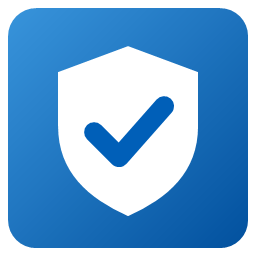
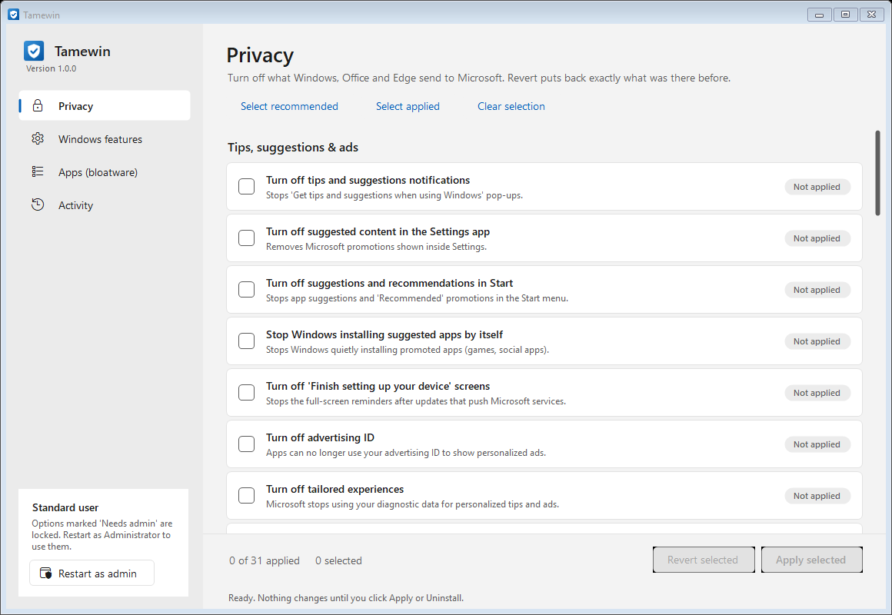
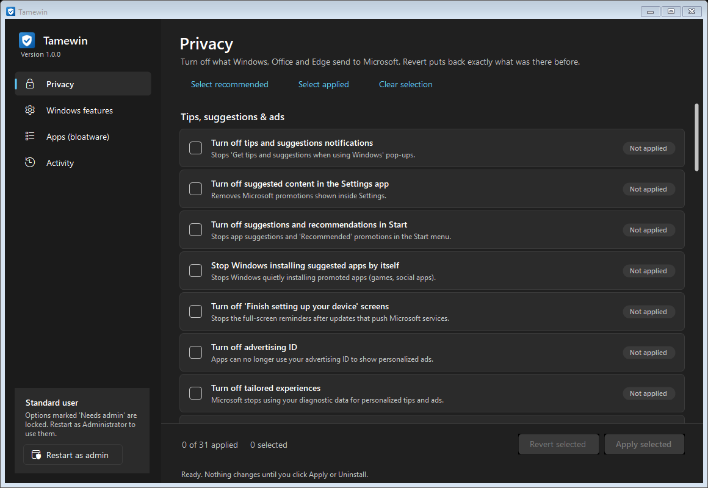
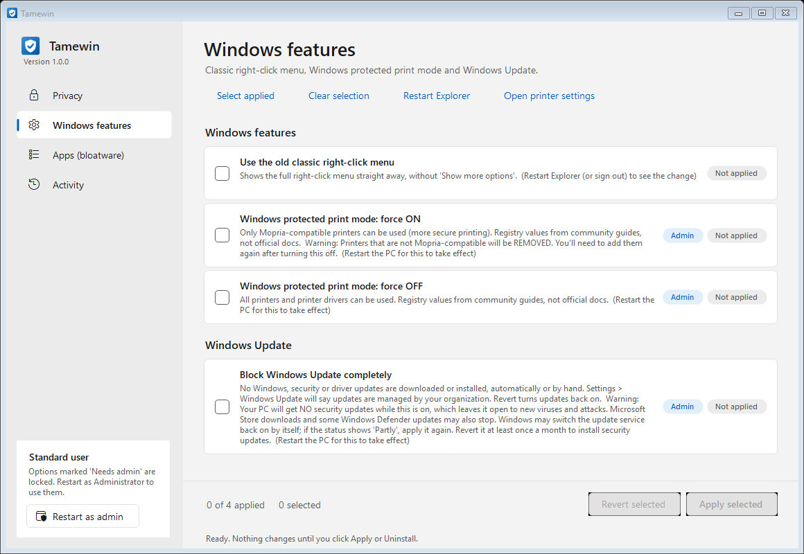

# Tamewin

Tame Windows: turn off the data it sends to Microsoft, remove bloatware, and
block updates — all reversible with one click.

<br clear="left">

Windows 10/11 tools, available as one portable **`Tamewin.exe`** or as PowerShell scripts:

- **Privacy & settings**: turn off Windows, Office and Edge data sharing, telemetry and diagnostic data, tips and ads. Undo puts back exactly what was there before.
- **Apps (bloatware)**: scans which preinstalled apps are installed and which aren't, rates each one (safe / think first / critical), says what stops working if you remove it, and uninstalls the ones you pick.
- **Classic right-click menu** and **Windows protected print mode** on/off.
- **Block Windows Update** completely, and turn it back on with one click.

Nothing touches your Microsoft account or sign-in.

## Tamewin.exe (recommended)

Download `Tamewin.exe` from the Releases page and double-click it. Nothing to install: it uses .NET Framework 4.8, which is built into Windows 10 and 11.



It follows your Windows light/dark setting:



The sidebar has four pages:

**Privacy.** Every option is a card with a one-line explanation and a status label (*Applied*, *Partly*, *Not applied*). Tick what you want, then click **Apply selected**. To undo, tick it and click **Revert selected**. **Select recommended** ticks the safe set. Options marked *Needs admin* are grey until you click **Restart as admin** in the sidebar.

**Windows features.** Classic right-click menu, Windows protected print mode on/off, and **Block Windows Update completely** (with **Restart Explorer** and **Open printer settings** buttons). Blocking updates stops all Windows, security and driver updates, including manual checks. It needs admin and a restart, and shows a warning first. Tick it and click **Revert selected** to turn updates back on. See [TECHNICAL.md](TECHNICAL.md#block-windows-update-block_updates).



**Apps (bloatware).** Scans your PC and lists every known preinstalled app as **Installed** or **Not installed**. You can search it and filter it to installed apps only. Apps are grouped as:
- **Safe to remove**: nothing else depends on it.
- **Think first**: a feature stops working (e.g. Snipping Tool means Win+Shift+S stops working).
- **CRITICAL - not recommended**: can break Windows features (Store, Windows Security, runtimes). Ticking one shows a warning you must confirm.
- **Other installed apps**: anything else removable that isn't in the list.

Each app's card says what stops working if you remove it. Uninstall is for your user account. To get an app back, click it and choose **Get from Store**.

**Activity.** A log of every change in this session, and a button that opens `%LOCALAPPDATA%\Tamewin`, where backups and the list of removed apps are kept.

Command line: `Tamewin.exe --list`, `--apply ad_id,tips`, `--apply recommended`, `--revert all`, `--apps`. Run `Tamewin.exe --help` for details.

### Is it safe? Antivirus
- **Open source:** everything is in `src/`. No network access, no hidden PowerShell, no packing or obfuscation. Registry changes use .NET's registry API, and apps are removed with Windows' own PackageManager API.
- Each release lists the EXE's **SHA-256**. Check it with `Get-FileHash Tamewin.exe`.
- **Not code-signed yet.** Windows SmartScreen may say "unknown publisher" (click *More info → Run anyway*). Some antivirus products flag *any* unsigned tool that changes privacy settings or removes apps. If yours does, please report it as a false positive. See [TECHNICAL.md](TECHNICAL.md#antivirus-and-false-positives).
- Build it yourself: `.\build.ps1` (needs the .NET SDK).

## PowerShell scripts

The original scripts still work and don't need the EXE.

Download or clone this repository, open PowerShell in its folder, then:

```powershell
.\Tamewin.ps1
```

```
=== Tamewin ===
  1) Privacy: turn off data sharing with Microsoft
  2) Privacy: restore original settings
  3) Classic right-click menu: on / off
  4) Windows protected print mode: on / off   (needs Administrator)
  Q) Quit
```

If scripts are blocked, run once: `Set-ExecutionPolicy -Scope CurrentUser RemoteSigned`

Each option can also be run on its own, as shown below.

## Privacy

```powershell
.\Apply-Privacy.ps1     # shows a menu: choose what to turn off (saves a backup first)
.\Revert-Privacy.ps1    # shows a menu: choose what to put back
```

```
Choose what to turn OFF:
  1) Tips, suggestions & ads  [14 settings]
  2) Search history & web search  [4 settings]
  3) Feedback, speech & typing  [6 settings]
  4) Office telemetry  [2 settings]
  5) Office connected experiences & feedback (needs Administrator)  [7 settings]
  A) All
  I) Pick individual settings
  Q) Quit
Your choice (e.g. 1,3):
```

Type one or more numbers (`1,3`), `A` for everything, or `I` to pick single settings from a numbered list (ranges work too, like `1,4,7-9`).

No menu:
```powershell
.\Apply-Privacy.ps1 -All                 # everything
.\Apply-Privacy.ps1 -Group Tips,Search   # groups: Tips, Search, Typing, Office, OfficeAdmin
.\Revert-Privacy.ps1 -Group Office       # undo just one group
.\Revert-Privacy.ps1 -All                # undo everything
```

These change only current-user settings (`HKEY_CURRENT_USER`). Sign out and back in (or restart) afterwards. The `OfficeAdmin` group needs **Run as Administrator**; without it those settings are reported as `SKIPPED`.

## Classic right-click menu

Brings back the full Windows 10-style right-click menu, so you don't have to click "Show more options".

```powershell
.\Set-ClassicMenu.ps1                    # menu: shows current state, choose on/off
.\Set-ClassicMenu.ps1 -On                # classic menu
.\Set-ClassicMenu.ps1 -Off               # Windows 11 menu
.\Set-ClassicMenu.ps1 -On -RestartExplorer   # apply right away (closes File Explorer windows)
```

Current user only, no admin needed.

## Windows protected print mode

```powershell
.\Set-ProtectedPrint.ps1                 # menu: status, on, off, default, open printer settings
.\Set-ProtectedPrint.ps1 -Status
.\Set-ProtectedPrint.ps1 -On             # ⚠ removes printers that aren't Mopria-compatible
.\Set-ProtectedPrint.ps1 -Off
.\Set-ProtectedPrint.ps1 -Default        # remove the policy, let the Settings app decide
```

Needs **Run as Administrator** for on/off/default. Restart the PC afterwards. The registry values aren't officially documented by Microsoft. If a change doesn't take effect, choose **4) Open printer settings** in the menu and use the toggle under **Settings → Bluetooth & devices → Printers & scanners**.

See [TECHNICAL.md](TECHNICAL.md) for exactly what each tool changes.

## More

- [TECHNICAL.md](TECHNICAL.md) — what every option changes, key by key.
- [ERROR-LESSONS.md](ERROR-LESSONS.md) — problems hit while building this, and their fixes.
- [COPYRIGHT](COPYRIGHT) — licence (MIT) and trademark notes.

## Licence

MIT. See [COPYRIGHT](COPYRIGHT). "Windows", "Microsoft", "Office" and "Edge" are
trademarks of Microsoft Corporation; Tamewin is not affiliated with Microsoft.
